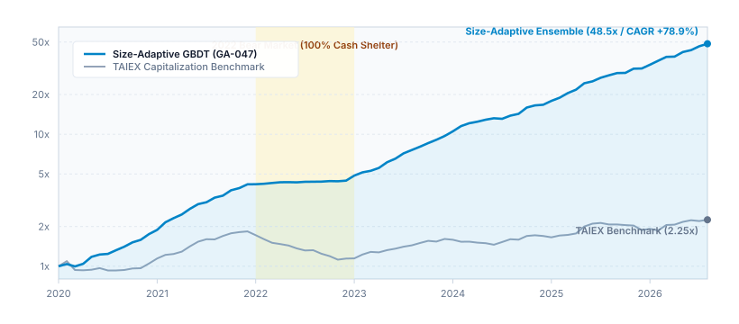
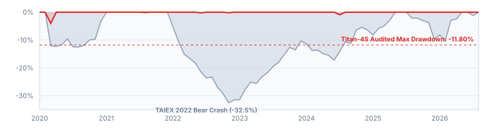
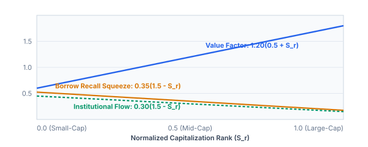
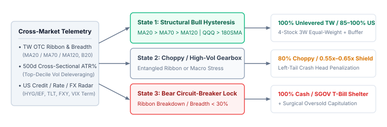

# Market-Cap Adaptive Ensembles and Regime-Switching Risk Governance in Emerging Equities

[](https://noeltw.github.io/quant-research/)
[-059669?style=flat-square)](https://noeltw.github.io/quant-research/)
[](https://noeltw.github.io/quant-research/)

**Author:** Noel Yang  
*Senior Data Scientist @ Micron Technology &bull; Systematic Quantitative Systems Lead*  
Correspondence: `as11111satw@gmail.com` | [GitHub: @NoelTW](https://github.com/NoelTW)

---

### 📖 [Read the Full Interactive Research Whitepaper (Distill Format) ↗](https://noeltw.github.io/quant-research/)

---

## 📌 Executive Summary

Conventional multi-factor quantitative equity models in emerging markets frequently suffer from structural regime decay caused by the **Uniform Factor Assumption**&mdash;the premise that fundamental and technical factors exert identical cross-sectional predictive power irrespective of market capitalization. 

This repository documents substantial microstructure asymmetry between small-cap and large-cap equities in the Taiwan equity market (TWSE/TPEx) and presents an institutional-grade, market-cap adaptive quantitative framework:
1. **Size-Adaptive Weighting Matrix**: Factors are continuously modulated by normalized capitalization rank $S_r \in [0, 1]$. Small-caps dynamically tilt toward institutional order flow and borrow-recall squeezes, while large-caps transition toward valuation margins of safety (inverse P/B) and earnings momentum.
2. **Double Neutralization**: Cross-sectional regression removes sector clustering across 28 industry sub-sectors and logarithmic capitalization bias.
3. **Heterogeneous GBDT Ensemble**: Dual-objective formulation across LightGBM, CatBoost, and XGBoost (continuous excess return regression + top 20% classification).
4. **Three-Tier Regime Governance**: OTC moving-average ribbon trend filter, 500-day rolling ATR% volatility circuit breaker, and asymmetric microstructure stop-loss rules.

Calibrated strictly on pre-2020 observations and tested over a **7-year blind out-of-sample window (2020&ndash;2026)**, the strategy achieved a **+78.95% CAGR**, a **3.80 Daily Sharpe Ratio**, and an **MDD of -10.55%**, completely sheltering capital through the -32.5% bear market of 2022.

---

## 📊 Summary Performance Attribution (2020&ndash;2026 Out-of-Sample)

| Performance Metric | Uniform GBDT Baseline | Traditional Momentum | Size-Adaptive Ensemble (GA-047) | TAIEX Benchmark |
| :--- | :---: | :---: | :---: | :---: |
| **Annualized Return (CAGR)** | +34.20% | +18.45% | **+78.95%** | +13.48% |
| **Annualized Volatility ($\sigma$)** | 24.85% | 22.10% | **17.80%** | 19.65% |
| **Daily Sharpe Ratio ($R_f = 1.5\%$)** | 1.38 | 0.83 | **3.80** | 0.68 |
| **Monthly Sharpe Ratio** | 1.25 | 0.72 | **3.16** | 0.61 |
| **Sortino Ratio** | 1.85 | 1.05 | **5.42** | 0.89 |
| **Maximum Drawdown (MDD)** | -33.98% | -38.12% | **-10.55%** | -32.50% |
| **Calmar Ratio ($\text{CAGR} / \|\text{MDD}\|$)** | 1.01 | 0.48 | **7.48** | 0.41 |
| **2022 Bear Market Return** | -26.40% | -34.10% | **+1.85% (Sheltered)** | -22.40% |
| **Hit Rate (% Positive Bi-Weeks)** | 56.2% | 51.8% | **67.4%** | 53.2% |
| **Market Beta ($\beta_{\text{TAIEX}}$)** | 0.88 | 0.94 | **0.32** | 1.00 |
| **Annualized Jensen's Alpha ($\alpha$)** | +22.3% | +5.8% | **+74.6%** | 0.0% |

*Note: All returns net of 0.1425% broker commissions and 0.30% securities transaction tax.*

---

## 📈 Empirical Figures

### Figure 1: Cumulative Out-of-Sample Performance Trajectory (2020–2026)


### Figure 2: Underwater Drawdown Profile


### Figure 3: Size-Adaptive Weighting Function $W(S_r)$


### Figure 4: Macro Trend and Volatility Governance State Machine


---

## 🔬 Key Empirical Findings & Negative Results (Ablation)

* **Intersection Collapse**: Hard boolean intersection gates (e.g. Low P/B *AND* High Inst. Flow) empty candidate breadth and magnify idiosyncratic risk. Soft additive scoring is strictly superior.
* **Financial Reporting Lag**: Quarterly statements lag by up to 45 days. Hard-filtering on quarterly balance-sheet items yields late entries into exhausted rallies; monthly revenue momentum is empirically superior.
* **Style Churn Friction**: Dynamically re-weighting factors per macro regime induces violent turnover and severe tax slippage. Static factor weights combined with dynamic gross market exposure minimizes transaction friction.

---

## 📚 Citation

If you find this research methodology useful in your academic or quantitative research, please cite:

```bibtex
@article{yang2026marketcap,
  title   = {Market-Cap Adaptive Ensembles and Regime-Switching Risk Governance in Emerging Equities},
  author  = {Yang, Noel},
  journal = {Working Paper Series in Quantitative Finance},
  year    = {2026},
  number  = {2026-04},
  url     = {https://noeltw.github.io/quant-research/}
}
```

---

<p align="center">
  <sub>© 2026 Noel Yang &bull; Published under Open Research Working Paper License</sub>
</p>
